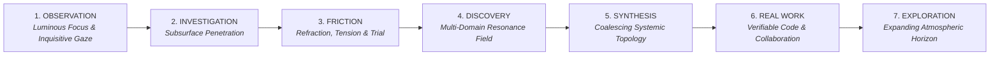

# THE LIVING SIGNAL — PAGE 02: "EVERY IDEA LEAVES A TRACE"
## Revised Master Creative Direction & Responsive Scrollytelling Specification (Revision 01)

**Document Version:** 2.0.0 (Owner Revision 01 Applied)  
**Date:** 2026-11-15  
**GSD Status:** DRAFT — AWAITING OWNER REVIEW & APPROVAL  
**Target Sequence:** All Ten Chapters (Sequences 01 through 04)  
**Primary Viewports:** Mobile Phones (360×800, 390×844, 430×932) & Laptop Displays (1280×720, 1366×768, 1440×900)

---

## 1. REVISED VISUAL METAPHOR: THE LIVING TRACE

### 1.1 Moving Beyond Drafting Boards and Specimen Plates
The previous "Architectural Codex" draft leaned too heavily on architectural drafting boards, parchment surfaces, coordinate callouts, and museum-like specimen plates. These static metaphors introduced unnecessary stylistic clutter and failed to convey the fluid, dynamic nature of software engineering, curiosity, and personal learning.

**The revised visual metaphor is THE LIVING TRACE.**

In physical reality, light leaves an exposure trace; in memory, an experience leaves an impression; in systems engineering, every process leaves an execution trace, a log record, or a commit hash. 

A visual trace in *The Living Signal* is not a single decorative line or a generic laser wire. It is **the luminous, tangible manifestation of an idea evolving through seven distinct phases of inquiry**:



### 1.2 The Seven Behavioral States of the Living Trace

1. **Observation (Chapter 01 — The Beginning):**
   - *Form & Behavior:* The trace originates as a delicate point of focus and a warm, low-intensity filament of light that subtly follows the narrative focal point—illuminating the central statement and guiding the eye toward the opening question. (Note: The approved portrait is a static photograph; zero webcam, biometric gaze tracking, or simulated eye movement is permitted). It is quiet, contemplative, and unhurried—representing the spark of an unanswered question.
2. **Investigation (Chapter 02 — Beyond the Interface):**
   - *Form & Behavior:* As curiosity deepens, the trace gains structural acuity. It does not peel like physical paper; it *penetrates* the visual surface plane, revealing the inner routing of services, data packets, and operating system logic. The light shifts from soft peach into warm amber and clear phosphor.
3. **Friction (Chapter 03 — The Learning Curve):**
   - *Form & Behavior:* The trace meets real resistance. It is explicitly non-linear: it encounters branching forks, diffraction, impedance, and tension—visually embodying the authentic friction of runtime errors, unexpected behavior, and independent debugging cycles before resolving into a clear, steady signal.
4. **Discovery (Chapter 04 — What Draws My Attention):**
   - *Form & Behavior:* The trace expands outward into a multi-dimensional relational field. It links the six engineering areas (Intelligent Systems, Automation, Systems/Linux, Software Engineering, Creative Tech, Technical Investigation) not as isolated boxes or floating cards, but as resonant harmonic nodes in an active network.
5. **Synthesis (Chapter 05 — How I Turn Ideas Into Systems):**
   - *Form & Behavior:* The disparate traces coalesce. The distributed energy routes consolidate into a disciplined, functional systemic topology—illustrating how separate tools and frameworks join to form a reliable architecture.
6. **Real Work (Chapters 06 & 07 — Selected Work & GrooveIt Collaboration):**
   - *Form & Behavior:* 
     - *Chapter 06:* The trace crystallizes into verifiable public code—linking directly to live GitHub pinned repositories, star counts, and commit timelines.
     - *Chapter 07:* The trace expands into a shared, collaborative fabric—representing pull request diffs, code review feedback threads, and the collective discipline of engineering within a team at GrooveIt.
7. **Future Exploration (Chapters 08, 09, 10 — The Lab, Horizon, & Connection):**
   - *Form & Behavior:*
     - *Chapter 08:* The trace becomes dynamic, generative, and exploratory in an active sandbox of local LLM inference streams and workflow telemetry.
     - *Chapter 09:* The trace dissolves its rigid contours and diffuses into an expansive, luminous atmospheric horizon—symbolizing the unmapped engineering frontiers ahead.
     - *Chapter 10:* The trace gently circles back to complete the circuit, returning to a grounded, serene composition alongside Aditya and clear contact pathways.

### 1.3 What Makes This Visual Behavior Distinctive
- **No Decorative Gimmicks:** The trace never appears as an arbitrary geometric sculpture, a floating particle cloud, or a decorative glowing wire. It only exists when it is carrying information, illuminating a concept, or connecting narrative thoughts.
- **Organic Reactivity:** The trace responds directly to scroll direction and velocity. Slow scrolling causes the trace to glow steadily and reveal finer structural sub-traces; reverse scrolling rewinds the trace along its exact historical trajectory.
- **Harmonious Palette:** Respects the non-negotiable palette rules from `MASTER_CREATIVE_BRIEF.md`: warm ivory, soft sky-blue, peach, warm coral, champagne gold, and terracotta. Strictly avoids neon-green AI clichés, rose-wine, deep navy corporate blues, or dark cyberpunk dashboards.

---

## 2. SEPARATE STORYBOARDS: MOBILE VS. LAPTOP

### 2.1 Laptop Visual Storyboard (1280×720, 1366×768, 1440×900)
*Rejecting the static 52/48 left-text/right-portrait split. Embracing fluid cinematic camera reframing.*

```
CHAPTER 01: THE OPENING CONVERGENCE (TEMPORARY CINEMATIC MOMENT)
┌─────────────────────────────────────────────────────────────────────────────┐
│ NAVIGATION: ADITYA DUGAR · WORK · SYSTEMS · JOURNEY · GET IN TOUCH ↗        │
├──────────────────────────────────────┬──────────────────────────────────────┤
│ Narrative Lead:                      │ ADITYA'S AUTHENTIC PORTRAIT          │
│ "I follow questions until            │ Anchored naturally in scene          │
│ they become something I can build."  │ Warm sunset horizon continuous       │
│                                      │ from Act 01.                         │
│ Faint observation trace sparks       │ Trace follows central statement.     │
└──────────────────────────────────────┴──────────────────────────────────────┘
                          │ (Scroll scrub initiates camera push into scene)
                          │ (Camera accelerates toward the narrative trace)
                          │ (Portrait recedes naturally; NOT a static 2-col layout)
                          ▼
CHAPTER 02: PENETRATING THE SUBSURFACE INVESTIGATION ENVIRONMENT
┌─────────────────────────────────────────────────────────────────────────────┐
│ (Camera moves deeply into the visual trace; Portrait recedes off-camera)    │
├─────────────────────────────────────────────────────────────────────────────┤
│ Headline & Story:                    │ SUBSURFACE INVESTIGATION FIELD       │
│ "There's always more happening       │ Trace penetrates surface plane,      │
│ beneath the surface."                │ illuminating real POSIX/network      │
│                                      │ routing architecture.                │
└─────────────────────────────────────────────────────────────────────────────┘
                          │ (Camera tracks right along the friction trace)
                          ▼
CHAPTER 03: THE FRICTION & TRIAL PATH
┌─────────────────────────────────────────────────────────────────────────────┐
│ ASYMMETRICAL INVESTIGATION CANVAS                                           │
│ The Living Trace encounters friction: splits into trial paths, undergoes    │
│ refraction, hits a runtime mismatch breakpoint, and converges into a passing│
│ verified resolution. Narrative annotations sit directly on the path.        │
└─────────────────────────────────────────────────────────────────────────────┘
                          │ (Camera lifts into wide spatial perspective)
                          ▼
CHAPTER 04: THE RESONANT DOMAIN FIELD
┌─────────────────────────────────────────────────────────────────────────────┐
│ 3D Spatial Field: Camera glides through 6 interconnected domain nodes       │
│ (Intelligent Systems, Automation, Systems, Software, Creative, Investigation)│
│ Active node brightens with editorial typography in conversational rhythm.   │
└─────────────────────────────────────────────────────────────────────────────┘
                          │ (Nodes converge inward)
                          ▼
CHAPTER 05: THE COALESCING SYSTEMIC TOPOLOGY
┌─────────────────────────────────────────────────────────────────────────────┐
│ Full-width System Topology Canvas:                                          │
│ Trace routes unify into a cohesive functional architecture:                 │
│ Client Layer ──► API Gateway ──► Local Model Inference ──► Persistence      │
│ Interactive signal pulses scrub across the dataflow.                        │
└─────────────────────────────────────────────────────────────────────────────┘
                          │ (Transition to evidence gallery)
                          ▼
CHAPTER 06: VERIFIABLE WORK (LIVE GITHUB EXHIBITION)
┌─────────────────────────────────────────────────────────────────────────────┐
│ Spotlight on Public Work:                                                   │
│ Dynamic GitHub GraphQL gallery populated directly from @AdityaDugar11       │
│ Pinned repositories displayed with verified stars, languages, and commits.  │
└─────────────────────────────────────────────────────────────────────────────┘
                          │ (Focus transitions to collaboration)
                          ▼
CHAPTER 07: COLLABORATIVE DISCIPLINE (GROOVEIT WORKSPACE)
┌─────────────────────────────────────────────────────────────────────────────┐
│ Shared Responsibility Canvas:                                               │
│ Side-by-side collaborative pull request interface showing sanitised         │
│ authentication refactoring, review feedback dialogs, and merged state.      │
└─────────────────────────────────────────────────────────────────────────────┘
                          │ (Ambient lighting shifts to twilight)
                          ▼
CHAPTER 08: THE EXPERIMENTAL LAB SANDBOX
┌─────────────────────────────────────────────────────────────────────────────┐
│ Focused Workbench: Dynamic token inference stream, node orchestration graph,│
│ and system resource telemetry for in-progress explorations.                 │
└─────────────────────────────────────────────────────────────────────────────┘
                          │ (Camera pulls back into expansive wide vista)
                          ▼
CHAPTER 09: THE EXPANDING HORIZON
┌─────────────────────────────────────────────────────────────────────────────┐
│ Vast, contemplative atmospheric horizon with wide negative space.           │
│ The trace softens into dawn light; narrative speaks to continuous growth.   │
└─────────────────────────────────────────────────────────────────────────────┘
                          │ (Camera descends smoothly to ground level)
                          ▼
CHAPTER 10: THE NEXT CONNECTION & INVITATION
┌─────────────────────────────────────────────────────────────────────────────┐
│ Harmonious Final Balance: Aditya's portrait re-emerges alongside refined,   │
│ accessible contact gateway (Email, LinkedIn, GitHub, Resume).               │
└─────────────────────────────────────────────────────────────────────────────┘
```

---

### 2.2 Mobile Visual Storyboard (< 768px)
*Rejecting the fixed 32vh header + card list. Embracing one continuous, seamless vertical world.*

```
┌──────────────────────────────────────────────┐
│ TOP STATUS: ADITYA DUGAR · THE LIVING SIGNAL │
├──────────────────────────────────────────────┤
│                                              │
│ CHAPTER 01: THE OPENING MOMENT               │
│ • Full-screen atmospheric viewport           │
│ • Aditya's authentic portrait integrated     │
│   directly into the warm sunset frame        │
│ • Display quote appears over natural depth   │
│ • First observation trace sparks at thumb    │
│                                              │
├──────────────────────────────────────────────┤
│                                              │
│ (Seamless vertical scroll transition)        │
│ • Portrait glides upward and dissolves       │
│   naturally into the sunset atmosphere       │
│                                              │
├──────────────────────────────────────────────┤
│                                              │
│ CHAPTER 02: SUBSURFACE FLOW                  │
│ • The trace dives vertically through scene   │
│ • Narrative stanzas appear inline at natural │
│   reading cadence (no card boxes)            │
│ • Embedded terminal insight renders as an    │
│   integrated typographic passage             │
│                                              │
├──────────────────────────────────────────────┤
│                                              │
│ CHAPTER 03: THE TRIAL PATH                   │
│ • Vertical branching trace showing friction  │
│ • Debugging milestone: tension point         │
│   resolves cleanly into verified signal      │
│ • Short, metered sentences for mobile eye    │
│                                              │
├──────────────────────────────────────────────┤
│                                              │
│ CHAPTER 04: CONNECTED DOMAINS                │
│ • Trace travels down through the 6 domains   │
│ • As each domain is reached, its name and    │
│   focus illuminate organically in the flow   │
│                                              │
├──────────────────────────────────────────────┤
│                                              │
│ CHAPTER 05: SYSTEM TOPOLOGY                  │
│ • Sleek vertical dataflow pipeline           │
│ • Luminous signal node tracks thumb progress │
│                                              │
├──────────────────────────────────────────────┤
│                                              │
│ CHAPTER 06: GITHUB REPOSITORIES              │
│ • Verified public pinned repositories        │
│ • Pure vertical feed (zero horizontal swipe) │
│ • Direct tap targets to GitHub URLs          │
│                                              │
├──────────────────────────────────────────────┤
│                                              │
│ CHAPTER 07: COLLABORATIVE CODE               │
│ • Embedded vertical PR review narrative      │
│ • Syntax-highlighted diff snippet with       │
│   constructive team commentary               │
│                                              │
├──────────────────────────────────────────────┤
│                                              │
│ CHAPTER 08: THE EXPERIMENTAL LAB             │
│ • Live interactive mobile lab stream         │
│ • Selectable tabs for AI, Automation, Linux  │
│                                              │
├──────────────────────────────────────────────┤
│                                              │
│ CHAPTER 09: STILL BECOMING                   │
│ • Spacious vertical gradient vista           │
│ • Contemplative reading interval             │
│                                              │
├──────────────────────────────────────────────┤
│                                              │
│ CHAPTER 10: THE NEXT CONNECTION              │
│ • Aditya's portrait re-emerges in closing    │
│ • Clean, touch-friendly contact buttons      │
│   (>= 48px height, accessible contrast)      │
│ • Return to Top button                       │
└──────────────────────────────────────────────┘
```

---

## 3. RESPONSIVE TRANSFORMATION MAP (ALL 10 CHAPTERS)

| Chapter | Mobile Architecture (< 768px) | Laptop Architecture (1280px–1440px) | Narrative Purpose & Trace Evolution |
| :--- | :--- | :--- | :--- |
| **01: The Beginning** | Full-screen integrated composition; portrait at base with headline above. | Dynamic opening balance: portrait center-right, editorial quote left. | **Phase 1: Observation.** The trace begins as an inquisitive point of focus. |
| **02: Beyond the Interface** | Portrait dissolves upward; vertical trace penetrates into system layer. | Camera pushes past portrait into spatial subsurface layer; system routes illuminate. | **Phase 2: Investigation.** The trace penetrates the surface to inspect lower-level systems. |
| **03: The Learning Curve** | Vertical branching path with inline debugging checkpoints; natural reading cadence. | Asymmetric investigation canvas; horizontal friction trace with callouts and test pass. | **Phase 3: Friction.** The trace encounters branching and tension before converging into clarity. |
| **04: What Draws My Attention** | Linear vertical journey through 6 domain waypoints; active domain lights up on scroll. | 3D spatial field; camera glides through 6 resonant domain nodes in depth. | **Phase 4: Discovery.** The trace branches into a multi-dimensional relational field. |
| **05: Ideas Into Systems** | Vertical pipeline diagram with step-by-step signal pulses. | Full-width architectural topology; interactive signal scrub across services. | **Phase 5: Synthesis.** Disparate traces consolidate into a functional systems architecture. |
| **06: Selected Work** | Single-column vertical repository cards (live GitHub data, direct links). | Dynamic exhibition gallery; highlighted active repository with code drawer. | **Phase 6A: Real Work.** Trace crystallizes into verified public code and commit histories. |
| **07: Engineering With Others** | Embedded vertical PR review card; syntax-highlighted diff + team notes. | Collaborative split canvas; unified pull request view with file tree and review threads. | **Phase 6B: Collaboration.** Trace weaves multiple contributors into a shared codebase. |
| **08: The Experimental Lab** | Mobile lab stream with segment toggles for Local AI, Automation, Systems. | Multi-pane live workbench: token streaming, node DAG execution, system HUD. | **Phase 7A: Sandbox.** Trace becomes exploratory, generative, and telemetry-driven. |
| **09: Still Becoming** | Spacious vertical gradient canvas; centered contemplative typography. | Expansive cinematic wide vista; trace diffuses into atmospheric dawn light. | **Phase 7B: Horizon.** Trace boundaries soften into open, unmapped possibilities. |
| **10: The Next Connection** | Portrait re-emerges; vertical stacked contact buttons ($\ge 48\text{px}$). | Rebalanced closing scene; portrait right, persistent contact gateway left. | **Phase 7C: Circuit Complete.** Trace connects the journey back to human conversation. |

---

## 4. AUTHENTICITY AUDIT: VERIFIED VS. ILLUSTRATIVE TECHNICAL EVIDENCE

Per mandatory owner requirements, we conduct an explicit authenticity audit. No unverified personal accomplishments, private code, synthetic metrics, or unverified system outputs may be presented as genuine historical fact.

### 4.1 Evidence Classification Matrix

| Technical Area | Proposed Element | Evidence Status | Approved Handling & Display Strategy |
| :--- | :--- | :--- | :--- |
| **Chapter 06: Selected Work** | Public Pinned Repositories, Star Counts, Primary Languages, Descriptions | **VERIFIED DYNAMIC** | Directly queried from Aditya’s public GitHub profile (`AdityaDugar11`) via server-side GraphQL. Rendered live with zero hardcoded fallbacks. |
| **Chapter 07: GrooveIt Experience** | Specific PR numbers, raw proprietary code, internal commit hashes, team names | **PRIVATE / UNVERIFIED** | **PROHIBITED:** Never invent or disclose private repository data. **APPROVED APPROACH:** Present a clearly labelled, sanitized conceptual pull request illustration: `[Illustrative Architectural Refactoring: Session Security & Middleware]`, referencing general collaborative learning. |
| **Chapter 02: System Calls** | Exact kernel version (`6.8.0`), process PID, hardcoded strace logs | **UNVERIFIED SPECIFIC** | **APPROVED APPROACH:** Present as a generic, educational POSIX system-level illustration (`Conceptual System Telemetry: POSIX Socket & IPC Communication`), demonstrating architectural principles rather than claiming historical hardware traces. |
| **Chapter 03: Debugging** | Specific JavaScript stack traces, exact unit test counts (`✓ 14 passing`) | **UNVERIFIED SPECIFIC** | **APPROVED APPROACH:** Use an illustrative, realistic debugging snippet labelled as an illustrative debugging cycle (`Example: Resolving runtime type impedance and async resolution`), focusing on the methodology of problem-solving. |
| **Chapter 05: System Topology** | Tech stack connections (FastAPI, React, Ollama, Supabase) | **VERIFIED CAPABILITY / CONCEPTUAL ARCHITECTURE** | Must be clearly presented as Aditya’s architectural approach to modern full-stack and local AI applications, not a claim that all tools were combined in a single production system. |
| **Chapter 08: Experimental Lab** | Local Ollama, ComfyUI node graphs, Linux system metrics | **PROHIBITED TO CLAIM LIVE**: Public client cannot access owner's local machines. | **APPROVED APPROACH:** Use owner-approved captured experiment recordings, clearly labelled illustrative interactive demonstrations, or client-side simulations. Never fabricate live system telemetry or simulate fake live metrics. |

---

## 5. UPDATED INTERACTION ARCHITECTURE & HYBRID SCROLL ENGINE

### 5.1 Rejecting the Giant Pinned Slideshow
Previous revisions proposed a single `580vh` or `680vh` pinned container that held the viewport hostage while scrubbing through all ten chapters. This caused user fatigue, trapped the browser scrollbar, and prevented natural reading.

**The revised architecture adopts HYBRID SCROLLYTELLING:**
- **Pinned Scrub Zones (Micro-Moments):** Used only where spatial continuity and camera transformation are essential:
  1. *Zone 1 (Page 01 $\rightarrow$ Page 02 Transition & Chapter 01 Opening):* Smooth camera push and portrait integration ($\sim 160\text{vh}$).
  2. *Zone 2 (Chapter 04 Domain Constellation $\rightarrow$ Chapter 05 Topology):* Fluid node convergence into systemic architecture ($\sim 180\text{vh}$).
- **Natural Reading Runways:** Chapters with substantive long-form narrative, dynamic GitHub repositories, and collaborative diffs (Chapters 02, 03, 06, 07, 08, 09, 10) flow with natural vertical document scrolling, allowing users to read at their own pace without scrollbar hijacking.

### 5.2 Mobile Touch Choreography
- Native vertical touch momentum scrolling (via Lenis or native iOS/Android momentum).
- Zero horizontal drag or swipe zones.
- All touch targets $\ge 48\text{px}$ with $\ge 12\text{px}$ clearance.
- Touch listeners passive by default; zero UI jank during rapid thumb gestures.

### 5.3 Laptop Camera Choreography
- Camera translation along smooth parametric bezier splines using Three.js and GSAP.
- Restrained mouse parallax capped at $\pm 3.5\text{px}$ with $0.08$ lerp damping.
- Zero idle drift: 3D elements never float autonomously away from their scroll state.

### 5.4 Reverse-Scroll Physics
- All GSAP ScrollTrigger timelines are strictly deterministic (`scrub: 0.4`).
- Reversing scroll cleanly rewinds the trace, reopens branches, and restores previous camera angles with zero ghosting or stale states.

### 5.5 Reduced-Motion Specification (`prefers-reduced-motion`)
- Scrub durations drop to `0.0` (immediate update).
- Three.js camera transitions are disabled; camera remains in fixed, optimal framing.
- Continuous 3D rotations and mouse parallax are disabled.
- Transitions use clean, standard opacity crossfades.

### 5.6 Measurable Performance Budgets

| Target Metric | Mobile Target (< 768px) | Laptop Target ($\ge 1280px$) | Verification Tool |
| :--- | :--- | :--- | :--- |
| **Frame Rate** | Sustained 60 FPS (zero drops $< 55\text{ FPS}$) | Sustained 60 FPS | Chrome DevTools FPS Meter / Stats.js |
| **Frame Render Time** | $\le 16.6\text{ms}$ per frame | $\le 16.6\text{ms}$ per frame | Chrome Performance Timeline |
| **JavaScript Heap** | $< 45\text{ MB}$ | $< 85\text{ MB}$ | Memory Snapshot Inspector |
| **DOM Node Count** | $< 850$ nodes total | $< 1200$ nodes total | `document.querySelectorAll('*').length` |
| **Draw Calls (WebGL)** | $\le 12$ draw calls per frame | $\le 28$ draw calls per frame | Three.js WebGLRenderer Info |
| **Cumulative Layout Shift** | $0.000$ | $0.000$ | Google Lighthouse / Web Vitals |

---

## 6. SOURCE-OF-TRUTH HIERARCHY & REPOSITORY GOVERNANCE

To eliminate ambiguity across all documentation and coding tools, the explicit source-of-truth hierarchy is codified as follows:

```
┌─────────────────────────────────────────────────────────────────────────────┐
│ 1. LATEST EXPLICIT DIRECTIVES FROM THE OWNER (e.g. Owner Revision 01)        │
├─────────────────────────────────────────────────────────────────────────────┤
│ 2. docs/PAGE_02_CREATIVE_DIRECTION.md (This Document — Tracked in Git)      │
├─────────────────────────────────────────────────────────────────────────────┤
│ 3. docs/MASTER_CREATIVE_BRIEF.md (Narrative, Core Values, 10 Chapters)      │
├─────────────────────────────────────────────────────────────────────────────┤
│ 4. APPROVED PAGE 01 DESIGN & SPECIFICATION:                                 │
│    • docs/reference/act-01-master-storyboard.png                            │
│    • docs/ACT_01_SPEC.md & docs/DESIGN_DECISIONS.md                         │
│    • Preserved Page 01 code (BackgroundVideo, HeroEditorial, Navigation)   │
├─────────────────────────────────────────────────────────────────────────────┤
│ 5. STRICTLY REJECTED DIRECTIONS (Never to be reintroduced):                 │
│    • Minecraft / voxel / low-poly character art                             │
│    • Anime character surrounded by three orbital rings                      │
│    • Arbitrary 3D monoliths, paper sculptures, or glass floating shapes     │
│    • Static 52/48 split-screen or 32vh header with stacked card list        │
│    • Giant single pinned slideshow hijacking entire 10 chapters             │
│    • Fabricated project metrics, PR numbers, or unverified system traces    │
└─────────────────────────────────────────────────────────────────────────────┘
```

- **File Tracking:** This document is permanently saved and tracked in the Git repository at [`docs/PAGE_02_CREATIVE_DIRECTION.md`](file:///home/adityadugar/Documents/Projects/Portfolio-experiment/docs/PAGE_02_CREATIVE_DIRECTION.md).
- **GSD Reference Fix:** [`.gsd/SPEC.md`](file:///home/adityadugar/Documents/Projects/Portfolio-experiment/.gsd/SPEC.md) references `docs/PAGE_02_CREATIVE_DIRECTION.md` directly.

---

## 7. FIRST PROTOTYPE SCOPE & MEASURABLE ACCEPTANCE CRITERIA

Before implementing the entire ten-chapter experience, we will build a tightly scoped, independently reviewable **First Prototype**.

### 7.1 Scope of the First Prototype
1. **The Entry & Chapter 01 (The Beginning):**
   - Natural transition from Act 01 exit into Page 02.
   - Laptop: Authentic portrait integrated naturally with left editorial narrative and initial low-intensity observation trace.
   - Mobile: Unified vertical frame with portrait, quote, and initial trace.
2. **The Chapter 01 $\rightarrow$ Chapter 02 Transition (Beyond the Interface):**
   - Laptop: Camera pushes forward, reframing the scene as the portrait recedes and the trace penetrates the subsurface layer.
   - Mobile: Portrait glides upward and dissolves smoothly as the trace leads the reader down into the subsurface investigation narrative.
3. **Responsive Continuity:**
   - Evaluated specifically at **390×844 (Mobile)** and **1440×900 (Laptop)**.

### 7.2 Measurable Acceptance Criteria for Prototype Approval
1. **Multi-Viewport Visual Continuity:**
   - Captured screen recordings at both 390×844 and 1440×900 demonstrating slow scroll, fast scroll, and full reverse scroll.
2. **Zero Layout Shifts:**
   - Cumulative Layout Shift strictly $= 0.00$. Zero text jump, zero portrait clipping.
3. **Fluid Reverse Scroll:**
   - Reversing scroll from Chapter 02 back to Chapter 01 and Act 01 is 100% deterministic with zero orphaned elements.
4. **Performance Verification:**
   - Sustained 60 FPS on both mobile and laptop simulation in Chrome DevTools.
5. **No Premature Replacement:**
   - Current Page 02 fallback components remain preserved until the prototype is reviewed and explicitly approved.

---

## 8. GOVERNANCE LOCK & NEXT STEPS

- **Planning Lock:** Active. No implementation code will be written until this revised specification is formally reviewed and approved by the owner.
- **Commit / Push Status:** Strictly paused. Zero unapproved commits or pushes.
